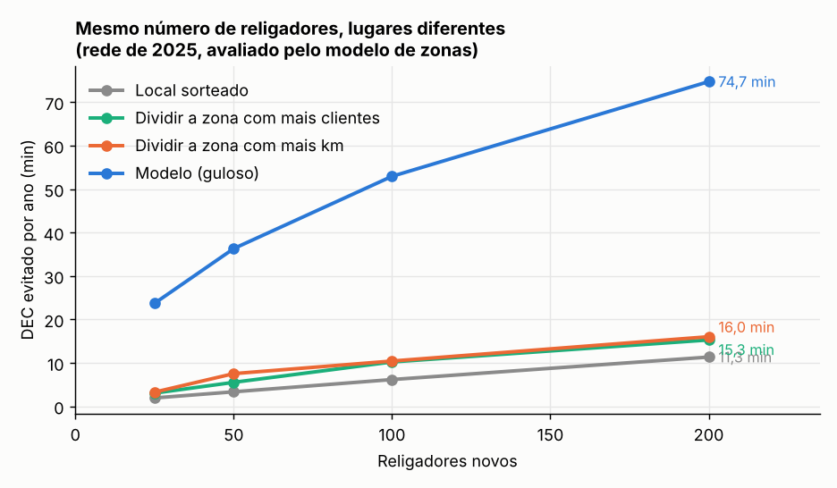
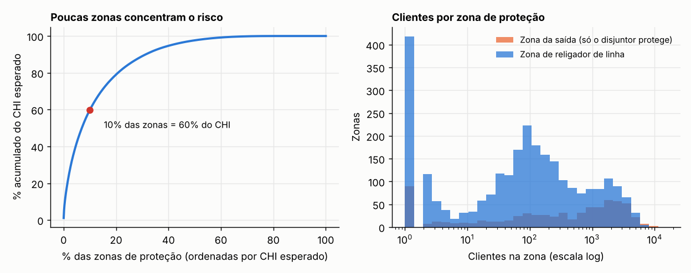
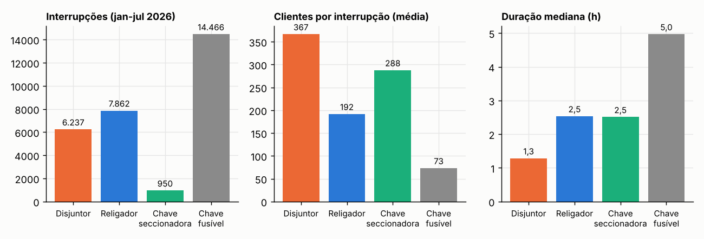
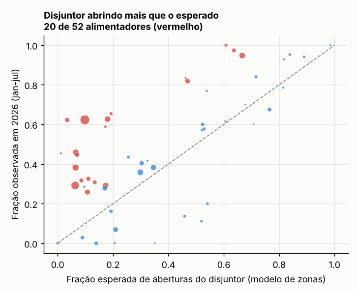
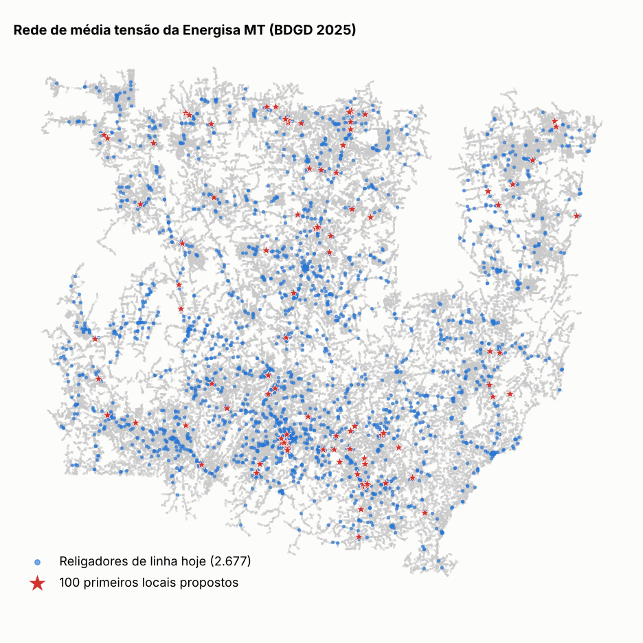
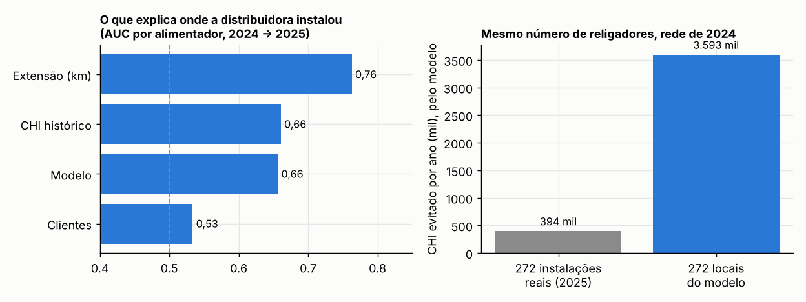
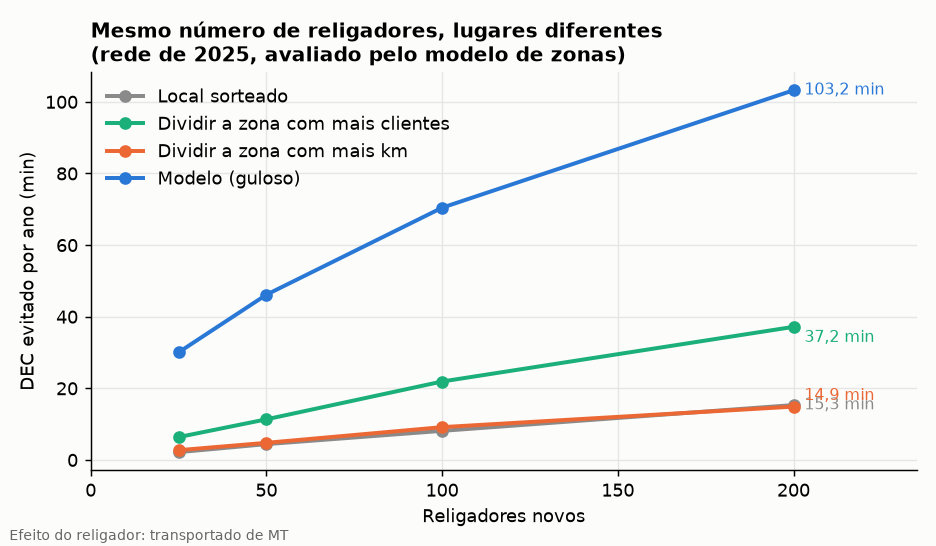

# Desempenho e posicionamento de religadores

[](https://github.com/CaioNepomuceno2/recloser-performance/actions/workflows/ci.yml)

-0b7a75)

**Os religadores estão no lugar certo, protegendo o que deveriam? Onde instalar os próximos para reduzir mais DEC?**

O projeto reconstrói a **topologia completa da rede de média tensão** da Energisa Mato Grosso a partir do cadastro
público da ANEEL (BDGD 2025: 2,1 milhões de segmentos, 208 mil km, 697 alimentadores, 4.060 religadores). Com ela,
calcula a **zona de proteção** de cada religador: quantos clientes e quantos km de rede ele protege. Depois cruza
isso com as **interrupções de 2026**, que agora informam qual equipamento abriu o circuito. Por fim, um modelo de
confiabilidade por zonas, validado contra o histórico, escolhe **onde instalar os próximos religadores**.

> Também roda para a **Energisa MS**, com os resultados e as ressalvas na seção [Energisa MS](#energisa-ms).

## Resultados em uma tela

| | |
|---|---|
| Topologia reconstruída | **99,9%** dos 2,05 milhões de clientes ligados à saída do seu alimentador |
| Modelo de zonas x CI observado por alimentador | Spearman **0,86** (636 alimentadores, 2023-2025) |
| Religadores de linha (com clientes a jusante) | **2.677**. Outros 513 fazem papel de disjuntor de saída na subestação |
| Zonas de religador com menos de 50 clientes | **39%**, e a zona mediana tem 88 clientes |
| Concentração do risco | **10% das zonas** de proteção respondem por **60%** do CHI esperado. Mais da metade delas é zona da saída, só com o disjuntor a montante |
| Onde a distribuidora instalou religadores em 2025 | Explicado sobretudo pela **extensão** do alimentador (AUC 0,76), não pelos clientes (0,53). **51%** das instalações protegem menos de 50 clientes |
| Mesmo número de religadores (272), nos locais do modelo | **9×** o CHI evitado das instalações reais, avaliado pelo mesmo modelo |
| 100 religadores novos, locais do modelo (rede 2025) | **53 min de DEC/ano** evitados, contra 10 min da regra "dividir a zona com mais km" e 6 min de locais sorteados |
| Disjuntor abrindo mais que o esperado (2026) | **20 de 52** alimentadores elegíveis, sinal de possível falta de coordenação |



> **Como ler.** Os ganhos de DEC são do modelo de zonas. A comparação com as regras simples usa o mesmo modelo para
> todas as opções, então mede a diferença entre os **locais**, não um ganho observado em campo. O modelo é
> **conservador** para instalações típicas: atribui 1.450 consumidores-hora/ano a cada religador instalado em 2025,
> contra 4.578 (IC 95%: 2.070 a 6.840) medidos por diferenças em diferenças no projeto irmão
> [`automation-impact`](https://github.com/CaioNepomuceno2/automation-impact). Um piloto é o que fecha a conta.

## 1. A rede e as zonas de proteção

O grafo liga segmentos, chaves e reguladores pelos pontos de acoplamento (PAC) da BDGD. As chaves normalmente
abertas (7.929) cortam a rede, e a raiz de cada alimentador é o seu início (`CTMT.PAC_INI`). Componentes
desconectados por falha de cadastro são religados ao nó mais próximo do mesmo alimentador. Foram 48 casos, com
lacuna mediana de 1,4 m, porque os PAC codificam a coordenada UTM. A zona de um religador vai dele até o próximo
religador a jusante. Faltas em ramais com chave fusível são eliminadas pelo fusível.

| Religadores no cadastro (2025) | |
|---|---|
| Total | 4.060 |
| Normalmente abertos (pontos de interligação) | 355 |
| De linha, com clientes a jusante | **2.677** |
| De saída: na subestação, antes do início do alimentador | 513 (em 512 alimentadores) |
| Sem clientes a jusante, outros casos de cadastro | 409 |
| Com telecomando (`TLCD = 1`) | 872 |



* **Muitos religadores protegem pouca gente.** A zona mediana de um religador de linha tem 88 clientes e 33 km de
  rede, e 39% das zonas têm menos de 50 clientes. Em geral são religadores em ramais rurais longos, o que faz
  sentido para a duração (o religador evita patrulhar a linha toda), mas pesa pouco no DEC.
* **O risco está concentrado.** As 342 zonas mais críticas (10%) concentram 60% do CHI esperado, e 53% delas são
  zonas da saída: clientes que hoje só têm o disjuntor da subestação entre eles e qualquer falta no tronco.
* 160 alimentadores não têm religador de linha (7% dos clientes e 2,5% da rede), quase todos curtos: só 2 deles estão entre os 25% mais longos.

## 2. Desempenho observado em 2026: quem abriu o circuito

As interrupções de 2026 (jan-jul) trazem o tipo de elemento interrompido. Nas faltas de média tensão da EMT:

| Elemento que abriu | Interrupções | Clientes por interrupção (média) | Duração mediana | Parte do CHI |
|---|---|---|---|---|
| Chave fusível | 14.466 | 73 | 5,0 h | 40% |
| Religador | 7.862 | 192 | 2,5 h | 29% |
| Disjuntor | 6.237 | 367 | 1,3 h | 24% |
| Chave seccionadora | 950 | 288 | 2,5 h | 5% |



O que isso significa: quando abre o disjuntor, o evento atinge em média 5 vezes mais clientes que um fusível, mas é
restabelecido em um quarto do tempo. O fusível é o oposto: atinge pouca gente, mas o atendimento exige deslocamento
e troca do elo, e por isso responde pela maior fatia do CHI.

**Sinal de seletividade.** Em alimentadores com saída por disjuntor e religador de linha, o modelo de zonas diz que
fração das faltas o disjuntor deveria eliminar (as do tronco antes do primeiro religador). Em 2026, em 20 dos 52
alimentadores elegíveis, o disjuntor abriu significativamente mais do que isso (teste binomial com correção de
Benjamini-Hochberg a 5%). A mediana observada foi 45%, contra 30% esperada. Esses 20 alimentadores somaram 630 mil
consumidores-hora em 2026. Sem a localização da falta, isso é um **indicador de suspeita** (coordenação
religador-disjuntor, ajuste, religador fora de serviço ou cadastro), não um diagnóstico.



## 3. Onde instalar os próximos religadores

O modelo calcula, para cada nó do tronco e para cada chave fusível, quanto CHI um religador ali evitaria:

* **No tronco (seccionamento):** faltas a jusante deixam de desligar os clientes entre o religador anterior e o novo.
* **No lugar de um fusível (religamento):** faltas transitórias no ramal deixam de queimar o elo. A premissa é que
  50% das faltas são transitórias, com sensibilidade de 30% a 70%.

A taxa de falhas por km e a duração vêm do histórico de cada alimentador (2023-2025), e o modelo é calibrado para
reproduzir o CHI observado de cada um. O algoritmo guloso instala um religador por vez no ponto de maior ganho e
recalcula o alimentador. Se a redução de CHI é monótona e submodular no conjunto de religadores, a garantia clássica do
guloso é de pelo menos 63% do ótimo, mas ela vale para a versão só com limite de quantidade. Aqui há duas restrições:
pelo menos 50 clientes protegidos e no máximo 3 religadores em série abaixo do disjuntor. Com elas o guloso é uma
heurística, e a garantia de 63% não está demonstrada. Nos testes com redes pequenas, ele coincidiu com a força bruta.

| Religadores novos | Modelo | Dividir a zona com mais km | Dividir a zona com mais clientes | Local sorteado |
|---|---|---|---|---|
| 25 | **23,7 min** | 3,3 min | 3,0 min | 1,9 min |
| 50 | **36,3 min** | 7,5 min | 5,5 min | 3,3 min |
| 100 | **52,9 min** | 10,4 min | 10,2 min | 6,2 min |
| 200 | **74,7 min** | 16,0 min | 15,3 min | 11,3 min |

*DEC evitado por ano sobre 2,13 milhões de consumidores, avaliado pelo mesmo modelo para todas as opções.*



* **Com 100 religadores:**
  * 1,9 milhão de consumidores-hora/ano evitados;
  * R$ 11,1 mi/ano na visão social (compensação + energia não suprida);
  * VPL social de R$ 93 mi em 20 anos, com R$ 160 mil por religador (custo ilustrativo).
* **Payback social:** mediana de 1,8 ano, e todos os 100 têm VPL social positivo.
* **Só com compensações:** o VPL fica em R$ 11 mi. É o mesmo padrão dos projetos irmãos: a compensação sozinha paga
  pouco da confiabilidade.
* **Onde ficam:** 72% dos locais estão no tronco e 28% são trocas de fusível por religador, espalhados por 81
  alimentadores.
* **A vantagem do modelo é robusta:** fica entre 4,5× e 7,3× a regra por extensão em todos os cenários testados.

| Sensibilidade (100 religadores) | Modelo | Regra por extensão | Razão |
|---|---|---|---|
| 50% de faltas transitórias (base) | 1,88 mi CH | 0,37 mi CH | 5,1× |
| 30% de faltas transitórias | 1,76 mi CH | 0,39 mi CH | 4,5× |
| 70% de faltas transitórias | 2,26 mi CH | 0,33 mi CH | 6,9× |
| Sem calibração por alimentador | 2,10 mi CH | 0,29 mi CH | 7,3× |
| Mínimo de 25 ou 100 clientes | 1,90 / 1,83 mi CH | 0,34 / 0,39 mi CH | 5,5× / 4,7× |

A lista priorizada dos 200 locais está em [`reports/lista_priorizada.csv`](reports/lista_priorizada.csv), com
alimentador, ponto da BDGD, coordenadas, clientes a jusante, DEC e R$ evitados e payback.

## 4. Backtest: a priorização de 2024 contra as instalações de 2025

Com a rede e o histórico de falhas até dez/2024, o modelo foi comparado com os **363 religadores que apareceram na
BDGD de 2025**. São religadores com código novo e sem religador de 2024 a menos de 100 m. Desses, 272 foram
localizados a até 50 m de um nó da rede de 2024.



* **A prática atual segue a extensão do alimentador.** O comprimento do alimentador separa bem os que receberam
  religador dos que não receberam (AUC 0,76). O número de clientes quase não separa (0,53), e o modelo fica no
  nível do CHI histórico (0,66).
* **51% das instalações protegem menos de 50 clientes a jusante, e 53% ficaram dentro de ramais com fusível.**
* **Os 272 religadores reais evitariam 394 mil consumidores-hora/ano** segundo o modelo. Nos 272 locais escolhidos
  pelo modelo, seriam 3,59 milhões (9×), pela mesma métrica.
* **O modelo é conservador.** Para as instalações reais, ele atribui 1.450 CH/ano por religador, cerca de um terço do
  efeito medido em campo pelo `automation-impact` (4.578; IC 95%: 2.070 a 6.840). O modelo só captura seccionamento e
  religamento. O efeito medido também inclui duração menor: o religador localiza a falta e evita patrulha. Por isso o
  ganho absoluto dos locais propostos tende a estar subestimado. Mas a diferença entre locais não foi medida em
  campo.

## Na prática: o que muda para quem decide

### O problema hoje
A instalação de religadores segue sobretudo a **extensão** do alimentador: AUC de 0,76 no backtest. Metade dos
religadores de 2025 protege menos de 50 clientes. Ao mesmo tempo, 10% das zonas de proteção concentram 60% do CHI
esperado. Mais da metade dessas zonas é zona da saída, em que milhares de clientes dependem só do disjuntor da
subestação.

O desempenho dos religadores também não é olhado com o que eles protegem. Um religador que nunca abre pode estar
numa zona sem faltas ou pode estar sendo atropelado pelo disjuntor. Nos dados de 2026, há 20 alimentadores em que o
disjuntor abre bem mais do que a topologia explica.

### O que se ganha

| Ganho | Quanto | De onde vem o número |
|---|---|---|
| Lista de onde instalar, com DEC e R$ por ponto | 200 locais priorizados | Modelo de zonas calibrado. Os locais são calculados, o ganho é modelado |
| Mais DEC pelo mesmo investimento | 100 religadores: 52,9 min/ano, contra 10,4 min da regra por extensão (5×; de 4,5× a 7,3× na sensibilidade) | Modelo, igual para todas as opções |
| Retorno social | VPL social de R$ 93 mi com 100 religadores, payback mediano de 1,8 ano | Modelo + R$/CHI do `automation-impact` + custo **ilustrativo** de R$ 160 mil |
| Alimentadores para revisar coordenação | 20 de 52 com disjuntor abrindo acima do esperado | **Medido** nas interrupções de 2026, contra o esperado pela topologia |
| Inventário de zonas de proteção | Clientes, km e falhas/ano de cada uma das 3.421 zonas | **Medido** no cadastro (BDGD) e no histórico de falhas |

### Por que aplicar
* O plano de investimento em automação precisa justificar cada religador em DEC/FEC e compensações. Uma lista que
  mostra o ganho por ponto, comparado com a regra atual, é um argumento direto para a diretoria e na fiscalização
  da ANEEL.
* A mesma verba pode render muitas vezes mais DEC quando o critério passa de "km de rede" para "clientes expostos a
  faltas".
* O sinal de seletividade aponta onde um ajuste de proteção, que custa muito menos que um equipamento novo, pode
  devolver DEC.

### Como aplicar (roteiro de adoção)
1. **Trocar o "elemento que abriu" da ANEEL pelos eventos do SCADA/ADMS.** Usar os eventos de proteção (ANSI 79
   religamento, 52 abertura de disjuntor, lockout), os contadores de operação e o religamento com sucesso de cada
   religador. Isso transforma o sinal de seletividade em diagnóstico por evento: quem abriu, quem deveria ter
   aberto, se religou ou bloqueou.
2. **Ligar a telemetria ao modelo.** Religador sem comunicação ou com comando falhando não faz o papel que o modelo
   supõe. Os indicadores de disponibilidade e assertividade de cada equipamento entram como fator de desconto na
   zona. Com os 872 telecomandados, dá para priorizar a manutenção de telecom pela zona que cada um protege.
3. **Calibrar as premissas** em [`configs/params.yaml`](configs/params.yaml): fração de faltas transitórias (pelos
   contadores de religamento com sucesso), custo do religador (banco de preços), limite de religadores em série
   (estudo de coordenação) e mínimo de clientes.
4. **Validar a lista com a engenharia de proteção.** Para os 20 a 30 primeiros pontos, conferir o estudo de
   coordenação, a viabilidade física (poste, acesso) e o canal de comunicação.
5. **Fazer um piloto com controle.** Instalar em N pontos da lista e comparar com N alimentadores parecidos sem
   instalação, como no desenho de diferenças em diferenças do `automation-impact`. O KPI é o CHI e o DEC da zona em
   12 meses.
6. **Rodar uma vez por ano**, junto do plano de obras, e publicar a lista e as zonas num painel Power BI a partir
   dos CSVs de `reports/`.

### Limites de uso
* Os ganhos são **modelados**. A diferença entre o modelo e as regras simples usa a mesma métrica para todos e não
  foi medida em campo.
* A taxa de falhas é uniforme por km dentro do alimentador. Trechos com vegetação, descargas ou idade diferentes
  terão taxas diferentes, e dados internos de ocorrência por trecho melhoram muito o modelo.
* A lista não substitui o estudo de proteção. "Máximo de 3 religadores em série" é uma simplificação da coordenação.
* O sinal de seletividade é estatístico e por alimentador. Ele indica onde olhar, não o que está errado.
* Os custos são **ilustrativos**. O VPL não deve ser usado como orçamento.

## Metodologia
O detalhamento está em [`docs/metodologia.md`](docs/metodologia.md): grafo e reparo de topologia, zonas, modelo de
confiabilidade e calibração, otimização, backtest, sinal de seletividade, premissas e interpretação de cada número.

## Energisa MS

O mesmo estudo roda para a **Energisa Mato Grosso do Sul** (código ANEEL 404) com `--config configs/params_ems.yaml`. As saídas ficam em
[`reports/ems/`](reports/ems/) e os resultados de MT não mudam. Os diagnósticos de dados e a **porta de qualidade pré-registrada** (a árvore
precisa ligar pelo menos 95% dos clientes à saída do alimentador para publicar locais de religador e backtest) foram escritos antes de qualquer resultado:
[`docs/decisoes_ems.md`](docs/decisoes_ems.md). Os resultados completos estão em [`docs/resultados_ems.md`](docs/resultados_ems.md).

> **O efeito do religador não foi medido em MS.** O `valor.json` de MS (projeto `automation-impact`) traz `origem_efeito = "transportado de MT"`: o efeito
> por religador é o de MT aplicado à exposição de MS. Toda saída daqui que lê esse arquivo repete o rótulo `origem_efeito`. Os ganhos de DEC são **do modelo de zonas**, não medidas de campo.

|  |  |
|---|---|
| Topologia reconstruída | **99,999%** dos 1,40 milhão de clientes ligados à saída do seu alimentador (mínimo pré-registrado: 95%) |
| Modelo de zonas x CI observado por alimentador | Spearman **0,82** (349 alimentadores, 2023-2025). O CI do modelo é 3,6 vezes o observado (razão mediana 0,28) |
| Religadores de linha (com clientes a jusante) | **1.721**. Outros 214 fazem papel de disjuntor de saída na subestação |
| Zonas de religador com menos de 50 clientes | **30%**, e a zona mediana tem 126 clientes |
| Concentração do risco | **10% das zonas** de proteção respondem por **50%** do CHI esperado. 59% delas são zona da saída |
| Onde a distribuidora instalou religadores em 2025 | Explicado sobretudo pela **extensão** do alimentador (AUC 0,73) e pelo CHI histórico (0,72), não pelos clientes (0,57). **43%** das instalações protegem menos de 50 clientes |
| Mesmo número de religadores (268), nos locais do modelo | **6×** o CHI evitado das instalações reais, avaliado pelo mesmo modelo |
| 100 religadores novos, locais do modelo (rede 2025) | **70 min de DEC/ano** evitados no modelo (**59 min** sem os alimentadores no piso da calibração), contra 9 min da regra "dividir a zona com mais km" e 8 min de locais sorteados |
| Disjuntor abrindo mais que o esperado (2026) | 6 de 91 alimentadores elegíveis. **Só descritivo**: o campo de elemento quase não registra disjuntor em MS |



* **A porta passou.** A topologia de 2025 liga 99,999% dos clientes à saída do alimentador (2024: 99,997%), contra 99,9% em MT. Os PAC de MS codificam a coordenada em UTM 21S para o estado todo, como em MT; foi conferido contra a geometria da BDGD
  (`decisoes_ems.md`, seção 2).
* **O guloso é uma heurística** com restrição de religadores em série. A garantia de 63% do guloso clássico não está demonstrada com essa restrição, e não é prometida.
* **Comparação com MT, só descritiva** (`resultados_ems.md`, seção 7): MS tem 3,6 vezes mais falhas por km nos registros da ANEEL e o modelo de zonas se ajusta pior (o CI do modelo é cerca de 3,6 vezes o observado, e 35% dos alimentadores ficam no piso da calibração).
* **Limites.** A calibração em MS é mais frágil que em MT (`resultados_ems.md`, seção 2): os alimentadores no piso da calibração têm 26% do CHI observado e levam 37% do DEC dos 100 primeiros locais (40% dos pontos),
  um viés do guloso para eles. Sem esses alimentadores, os 100 primeiros evitam 59 min por ano em vez de 70 (`resultados_ems.md`, seção 5; a razão do backtest não muda). O backtest infere "instalação nova" de dois cadastros que misturam instalação, remanejamento e recadastramento: a regra de MT é a principal e uma sensibilidade por `DAT_CON` sai ao lado. 2026 não tem
  nenhum registro em março, e o campo de elemento quase não registra disjuntor, então o sinal de seletividade é só descritivo.

```bash
python scripts/00_cache_bdgd.py --config configs/params_ems.yaml    # lê os zips locais da BDGD de MS (cache somente leitura)
python scripts/01_topologia.py  --config configs/params_ems.yaml    # e 02 a 06, com o mesmo --config (ou RECLOSER_CONFIG)
```

## Reproduzir

```bash
pip install -e ".[dev]"
python scripts/00_cache_bdgd.py        # BDGD 2024 e 2025 (ANEEL/ArcGIS), ~1 GB cada, extrai só as camadas usadas
python scripts/01_topologia.py         # árvore radial dos alimentadores
python scripts/02_diagnostico.py       # zonas, inventário e validação do modelo
python scripts/03_desempenho_2026.py   # quem abriu o circuito em 2026 e sinal de seletividade
python scripts/04_backtest.py          # priorização de 2024 x instalações de 2025
python scripts/05_otimizacao.py        # onde instalar, regras simples e sensibilidade
python scripts/06_figuras.py
pytest
```

Pré-requisitos dos projetos irmãos, apontados em `configs/params.yaml`:
* `falhas.parquet` e `interrupcoes_emt.parquet` do
  [`distribution-asset-risk`](https://github.com/CaioNepomuceno2/distribution-asset-risk) (rode o pipeline dele);
* `reports/valor.json` do [`automation-impact`](https://github.com/CaioNepomuceno2/automation-impact) (R$/CHI e
  efeito medido).

## Estrutura

```
src/recloser/
  topologia.py    grafo da BDGD, reparo de lacunas, árvore radial, religadores de saída
  zonas.py        zonas de proteção, modelo de confiabilidade por zonas, ganho de cada nó
  otimizacao.py   guloso com recálculo, regras simples de comparação
  analise.py      modelo calibrado de um ano e validação
  dados.py        falhas históricas, interrupções de 2026 e valoração
scripts/          00 a 06, na ordem de execução
configs/          premissas e recorte
docs/             metodologia
reports/          resultados em CSV/JSON e figuras
```

## Limitações
* **Cadastro.** 409 religadores ficam sem clientes a jusante por arranjos que a topologia não resolve, e 9 estão em
  laços (chave de by-pass fechada no cadastro). Os códigos de tipo de unidade (`TIP_UNID`) seguem o mesmo mapa do
  `distribution-asset-risk` (PRODIST Módulo 10).
* **Vínculo de 2026.** 79% das interrupções de 2026 têm o alimentador no cadastro de 2025. Em 512 alimentadores a
  saída é um religador, e o dado não separa a abertura do religador de saída da de um religador de linha. Por isso
  o sinal de seletividade só usa alimentadores com saída por disjuntor.
* **Modelo.** A taxa de falhas é uniforme por km, a duração por alimentador vem do histórico, e não há transferência
  de carga por chaves normalmente abertas, que reduziria a duração para parte dos clientes. O fator de calibração
  por alimentador fica limitado entre 0,2 e 5.
* **Backtest.** A "instalação nova" é inferida pela diferença entre dois cadastros. Parte pode ser recadastramento:
  184 dos 363 têm a data-padrão de 1980.

---
Autor: **Caio Nepomuceno**. Dados públicos da ANEEL (BDGD e interrupções). Projeto independente, sem vínculo com a
Energisa ou com a ANEEL.
