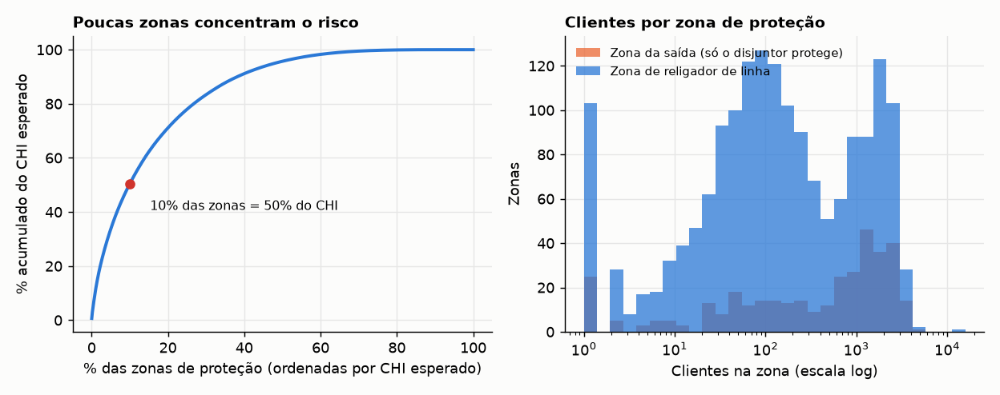
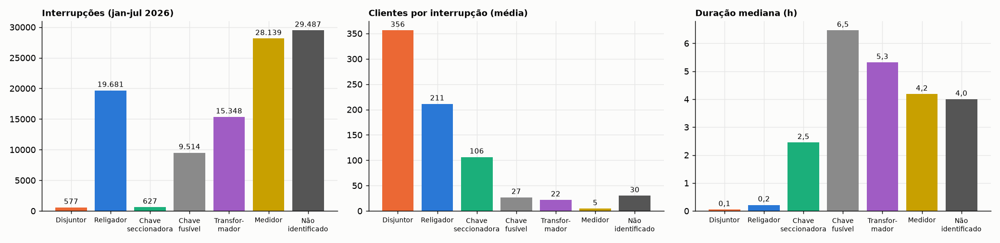
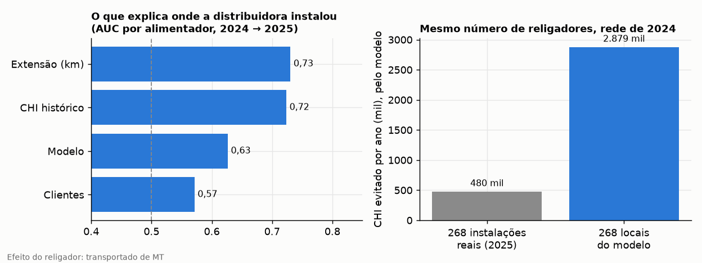
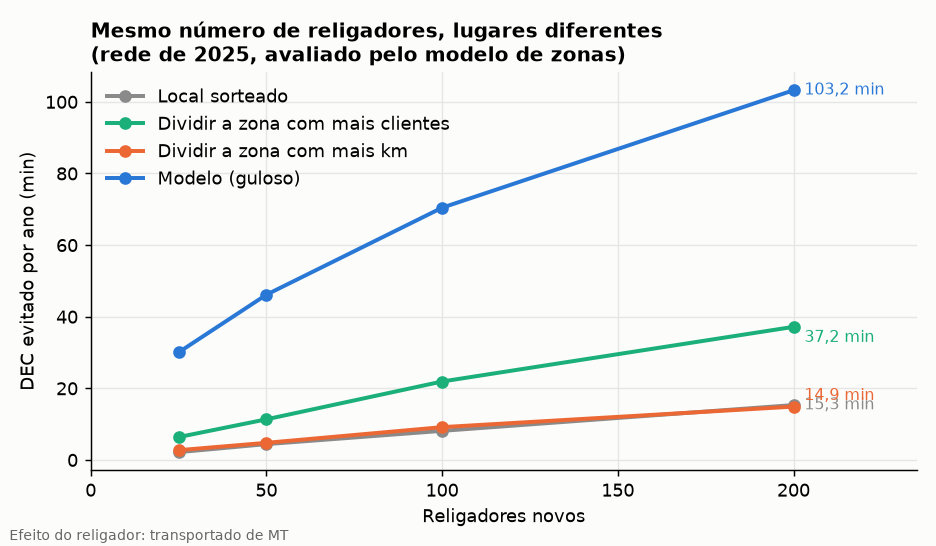
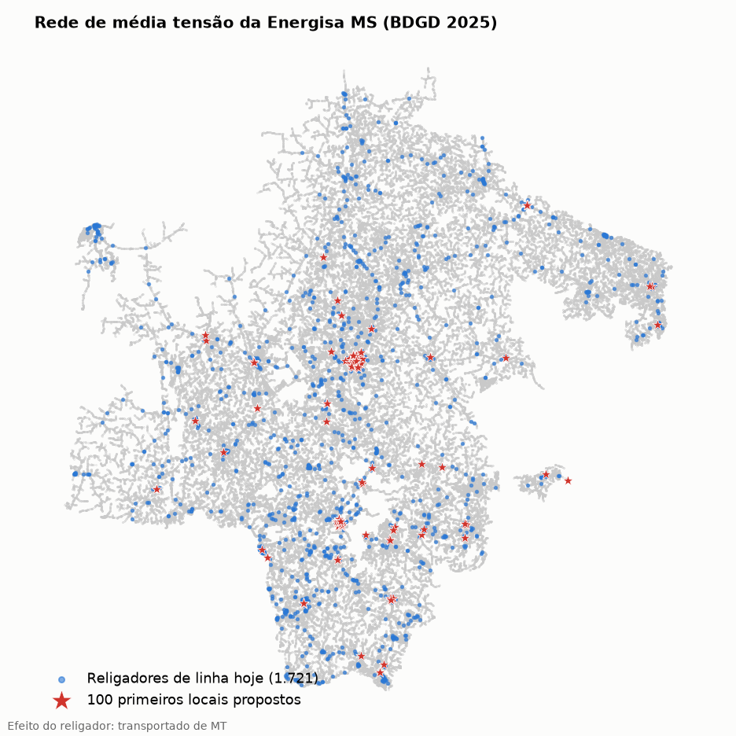

# Resultados da Energisa MS (EMS)

Resultados do mesmo estudo de MT (zonas de proteção, desempenho de 2026, backtest e posicionamento de religadores) aplicados à
**Energisa Mato Grosso do Sul**, com a BDGD de 31/12/2025 (rede atual) e de 31/12/2024 (backtest). Só dados abertos da ANEEL.
As decisões de dados, os diagnósticos e a porta de qualidade foram escritos e commitados **antes** de qualquer resultado:
[`decisoes_ems.md`](decisoes_ems.md). Todo número deste documento sai de arquivos de [`reports/ems/`](../reports/ems/),
regenerados por `scripts/01` a `06`; as tabelas são impressas por `scripts/tabelas_docs.py`. Execução de 07/11/2026.

> **O efeito do religador não foi medido em MS.** O `valor.json` de MS (projeto `automation-impact`) traz
> `origem_efeito = "transportado de MT"`: o efeito por religador é o de MT aplicado à exposição de MS. Toda saída que lê esse arquivo
> repete o rótulo (`backtest.json`, `backtest_instalacoes.csv`, `curva_k.csv`, `sensibilidade.csv`, `lista_priorizada.csv`,
> `otimizacao.json` e as figuras 01, 02 e 05). Os ganhos de DEC abaixo são **do modelo de zonas**, não medidas de campo.

> Projeto independente, sem vínculo com a Energisa ou com a ANEEL. Só dados abertos (ANEEL e IBGE).

## Em uma tela

|  |  |
|---|---|
| Topologia reconstruída | **99,999%** dos 1,40 milhão de clientes ligados à saída do seu alimentador (mínimo pré-registrado: 95%) |
| Modelo de zonas x CI observado por alimentador | Spearman **0,82** (349 alimentadores, 2023-2025). O CI do modelo é 3,6 vezes o observado (razão mediana 0,28) |
| Religadores de linha (com clientes a jusante) | **1.721**. Outros 214 fazem papel de disjuntor de saída na subestação |
| Zonas de religador com menos de 50 clientes | **30%**, e a zona mediana tem 126 clientes |
| Concentração do risco | **10% das zonas** de proteção respondem por **50%** do CHI esperado. 59% delas são zona da saída |
| Onde a distribuidora instalou religadores em 2025 | Explicado sobretudo pela **extensão** do alimentador (AUC 0,73) e pelo CHI histórico (0,72), não pelos clientes (0,57). **43%** das instalações protegem menos de 50 clientes |
| Mesmo número de religadores (268), nos locais do modelo | **6×** o CHI evitado das instalações reais, avaliado pelo mesmo modelo |
| 100 religadores novos, locais do modelo (rede 2025) | **70 min de DEC/ano** evitados no modelo (**59 min** sem os alimentadores no piso da calibração), contra 9 min da regra "dividir a zona com mais km" e 8 min de locais sorteados |
| Disjuntor abrindo mais que o esperado (2026) | 6 de 91 alimentadores elegíveis. **Só descritivo**: o campo de elemento quase não registra disjuntor em MS |

## 1. A porta de qualidade e a topologia

A regra pré-registrada exigia que a reconstrução ligasse pelo menos 95% dos clientes à saída do seu alimentador para publicar
posicionamento e backtest. **Passou nos dois snapshots**, com folga, e por isso tudo abaixo foi publicado.

|  | 2025 | 2024 |
|---|---|---|
| Circuitos | 362 | 359 |
| Nós da rede (PAC) | 1.203.393 | 1.161.133 |
| Clientes ligados a um transformador ou PAC | 1.404.771 | 1.458.108 |
| **Ligados à saída do alimentador, depois do reparo (a porta)** | **1.404.759 (99,999%)** | **1.458.062 (99,997%)** |
| Mínimo pré-registrado e veredito | 95%: passou | 95%: passou |
| Antes do reparo de lacunas | 95,31% | 95,71% |
| Componentes religados (lacuna mediana; P90) | 22 (0,8 m; 11,8 m) | 48 (0,7 m; 2,2 m) |
| Clientes alcançados no mesmo circuito do cadastro | 100,00% | 100,00% |
| Chaves normalmente abertas (fora do grafo) | 4.688 | 4.243 |
| Circuitos sem saída no grafo | 0 | 0 |

* O reparo de lacunas (religa um componente ao nó mais próximo do mesmo circuito, a até 500 m) leva a cobertura de 95% para
  quase 100%. As lacunas são pequenas (mediana abaixo de 1 m, como em MT, porque os PAC codificam a coordenada UTM 21S; ver a
  seção 2 de `decisoes_ems.md`).
* Os clientes que a árvore alcança caem no mesmo circuito do seu transformador no cadastro em 100% dos casos.
* Nada foi ajustado para passar a porta: `max_gap_m` ficou em 500 m e as premissas são as de MT.

## 2. A rede e as zonas de proteção (2025)

| Religadores no cadastro (2025) |  |
|---|---|
| Total | 2.646 |
| Normalmente abertos (pontos de interligação) | 417 |
| De linha, com clientes a jusante | 1.721 |
| De saída: na subestação, antes do início do alimentador | 214 |
| Sem clientes a jusante, outros casos de cadastro | 137 |
| Com telecomando (`TLCD = 1`) | 1.809 |

|  | 2025 |
|---|---|
| Zonas de religador de linha | 1.721 |
| Clientes na zona: mediana e P90 | 126 e 1.930 |
| Rede na zona: mediana e P90 (km) | 19,8 e 125,2 |
| Zonas com menos de 50 clientes | 29,9% |
| Zona da saída: clientes e km (medianas) | 633 e 10,2 |
| Zonas de proteção (saída, religador de linha, seccionalizador) | 2.443 |
| As 10% mais críticas: parte do CHI esperado | 50% |
| ... das quais zona da saída | 59% |
| Alimentadores sem religador de linha (parte dos clientes e da rede) | 39 (1,9% e 0,9%) |
| ... entre os 25% mais longos | 0 |
| Rede de MT (km) e falhas por 100 km por ano | 91.453 e 118,8 |
| Modelo x CI observado: Spearman (alimentadores) | 0,82 (349) |
| CI observado sobre CI do modelo: razão mediana | 0,28 |



* **A zona de um religador** vai dele até o próximo religador a jusante. Faltas em ramais com chave fusível são eliminadas pelo fusível.
* **O risco está concentrado**, como em MT, e mais da metade das zonas mais críticas é zona da saída (só o disjuntor ou o religador de
  saída entre o cliente e a falta no tronco).
* **MS tem muito mais falhas por km** que MT (comparação descritiva na seção 7), e o CI observado de MS é bem menor que o do modelo. Isso afeta a
  calibração (próxima tabela).

### Calibração do modelo

A taxa de falhas é uniforme por km dentro de cada alimentador e o fator de calibração (CI observado / CI do modelo) fica limitado entre 0,2 e 5,
como em MT. Em MS o CI do modelo é cerca de 3,6 vezes o observado, e **o piso de 0,2 vale para uma parte grande dos alimentadores**:

| Grupo | Alimentadores | CHI observado (média anual) | CHI do modelo calibrado | Modelo sobre observado |
|---|---|---|---|---|
| Todos os alimentadores com histórico | 350 | 19,22 mi | 21,41 mi | +11,4% |
| Razão CI observado / CI do modelo abaixo de 0,2 (no piso da calibração) | 124 | 4,97 mi | 7,16 mi | +44,1% |
| Demais | 226 | 14,26 mi | 14,25 mi | 0,0% |

Nos alimentadores fora do piso o modelo calibrado reproduz o CHI observado. Nos que ficam no piso, o CHI do modelo é maior que o observado. Não
mexi no limite (seria ajustar premissa olhando resultado); a leitura dos ganhos tem que levar isso em conta, e a seção 5 mede quanto do ganho vem desses alimentadores. A explicação do descompasso não foi testada. Ela é compatível com
muitos registros de MS que afetam poucos clientes (no arquivo de 2026, as interrupções em `MEDIDOR` e `TRANSFORMADOR` têm 5 e 22 clientes em média).

## 3. Desempenho observado em 2026: quem abriu o circuito

O arquivo de interrupções de MS de 2026 vai de janeiro a julho, **sem nenhum registro em março**, e o campo de elemento só vem preenchido em
100% das interrupções em janeiro (30% em abril). Os números abaixo são **descritivos**.

| Elemento que abriu | Interrupções | Clientes por interrupção (média) | Duração mediana | Parte do CHI |
|---|---|---|---|---|
| NAO IDENTIFICADO | 29.487 | 30 | 4,0 h | 24% |
| MEDIDOR | 28.139 | 5 | 4,2 h | 4% |
| RELIGADOR | 19.681 | 211 | 0,2 h | 32% |
| TRANSFORMADOR | 15.348 | 22 | 5,3 h | 19% |
| CHAVE FUSIVEL | 9.514 | 27 | 6,5 h | 18% |
| CHAVE SECCIONADORA | 627 | 106 | 2,5 h | 2% |
| DISJUNTOR | 577 | 356 | 0,1 h | 1% |



|  |  |
|---|---|
| Interrupções de MT de 2026 (jan-jul, sem março) | 103.373 |
| Casam com um circuito do cadastro de 2025 | 84,2% |
| Alimentadores elegíveis (saída por disjuntor, religador de linha, 10 ou mais aberturas) | 91 |
| Com o disjuntor abrindo mais que o esperado (Benjamini-Hochberg, 5%) | 6 |
| Fração de aberturas do disjuntor: esperada e observada (medianas) | 22% e 0% |
| Spearman do CHI do modelo com o CHI de 2026 (alimentadores) | 0,67 (344) |

* **O sinal de seletividade não é indicador de coordenação em MS.** O elemento `DISJUNTOR` é menos de 1% das interrupções e a fração observada de aberturas do disjuntor é, na mediana, 0%, contra 22% esperada pela topologia. O
  resultado reflete como o campo é preenchido em MS. O número de alimentadores com "suspeita" está na tabela, só para registro.
* A figura 06 (`reports/ems/figures/06_seletividade.png`) mostra os alimentadores elegíveis.

## 4. Backtest: a priorização de 2024 contra as instalações de 2025

O backtest usa a rede de 2024 e o histórico de falhas de 2022 a 2024. "Instalação nova" é o religador fechado de 2025 sem o mesmo `COD_ID`
de 2024 e sem religador de 2024 a menos de 100 m (a regra de MT); localizado a até 50 m de um nó da rede de 2024.

|  | Regra de MT (principal) | Sensibilidade: `DAT_CON` em 2024 ou 2025 |
|---|---|---|
| Religadores novos | 291 | 231 |
| Localizados a até 50 m de um nó da rede de 2024 | 268 | 213 |
| Alimentadores que receberam | 107 | 85 |
| AUC: extensão do alimentador | 0,73 | 0,73 |
| AUC: CHI histórico | 0,72 | 0,70 |
| AUC: modelo (maior ganho) | 0,63 | 0,59 |
| AUC: clientes | 0,57 | 0,55 |
| Instalações com menos de 50 clientes a jusante | 43% | 45% |
| Instalações dentro de ramal com fusível | 35% | 39% |
| Instalações com ganho no modelo | 36% | 33% |
| Instalações no top 10% dos candidatos | 7% | 6% |
| CHI evitado por ano, instalações reais (modelo) | 480 mil | 294 mil |
| CHI evitado por ano, mesmo número de locais do modelo | 2.879 mil | 2.560 mil |
| Razão (locais do modelo / instalações reais) | 6,0× | 8,7× |



* **A prática segue a extensão e o CHI histórico do alimentador**, e menos os clientes e o modelo. A conclusão é a mesma com a regra principal e com a sensibilidade que só
  aceita religadores com `DAT_CON` em 2024 ou 2025.
* **O modelo não é o que melhor explica onde se instalou** (AUC menor que o da extensão e do CHI histórico): o backtest mede se a priorização por ganho de DEC
  reproduz a prática, e não reproduz. Isso não diz que a prática está errada (religador em linha longa também reduz patrulha, efeito que o modelo não captura).
* **Mesmo número de religadores nos locais do modelo evita muito mais CHI que as instalações reais**, pelo mesmo modelo. É diferença entre locais com a mesma régua, não ganho medido em campo.
  Mais da metade dos locais do modelo cai em alimentadores no piso da calibração (tabela da seção 5), mas a razão da regra principal não depende deles: sem esses alimentadores, dos dois lados, ela continua a mesma (a sensibilidade por `DAT_CON` não foi refeita assim).
* **A comparação com o efeito do `valor.json` não valida o modelo.** Em MT, o `automation-impact` mediu o efeito em campo; em MS ele é o de MT (`origem_efeito`),
  aplicado à exposição de MS. Os campos `chi_evitado_ano_did_por_religador` e `fator_did_sobre_modelo` de `backtest.json` ficam, por isso, sem leitura.

### O cadastro de MS mistura instalação e remanejamento

A "instalação nova" é inferida da diferença entre dois cadastros e **não separa instalação, remanejamento e recadastramento**. O que se mediu no par 2024 x 2025 está em
`decisoes_ems.md` (seção 5): o `COD_ID` dos religadores é estável (poucos somem), 79% dos novos têm `DAT_CON` em 2024 ou 2025, e 21% têm `DAT_CON` anterior. O salto do cadastro de
2025 (chaves fusíveis, seccionalizadores e telecomando) sugere uma atualização cadastral grande. Por isso a sensibilidade por `DAT_CON` sai ao lado da regra principal, e nenhum pareamento foi forçado.

## 5. Onde instalar os próximos religadores (rede de 2025)

O guloso instala um religador por vez no ponto de maior ganho e recalcula o alimentador. É uma **heurística**: o ganho de religadores tem estrutura submodular, mas com as duas restrições do estudo
(pelo menos 50 clientes protegidos e no máximo 3 religadores em série abaixo do disjuntor) a garantia clássica de 63% do ótimo não está demonstrada e não é prometida.
Nos testes com redes pequenas ele coincide com a força bruta. As regras de comparação usam o mesmo modelo.

| Religadores novos | Modelo (guloso) | Dividir a zona com mais km | Dividir a zona com mais clientes | Local sorteado |
|---|---|---|---|---|
| 25 | 30,0 min | 2,7 min | 6,4 min | 2,2 min |
| 50 | 46,1 min | 4,8 min | 11,3 min | 4,4 min |
| 100 | 70,4 min | 9,2 min | 21,9 min | 8,1 min |
| 200 | 103,2 min | 14,9 min | 37,2 min | 15,3 min |

*DEC evitado por ano, sobre os 1.458.167 consumidores do `valor.json` (cadastro de 2024), avaliado pelo mesmo modelo para todas as opções.*



| Religadores novos (guloso) | CHI evitado por ano | DEC evitado (min/ano) | R$/ano, visão social | VPL social (20 anos) | VPL só com compensações |
|---|---|---|---|---|---|
| 25 | 0,73 mi | 30,0 | R$ 4,1 mi | R$ 35,9 mi | R$ 4,1 mi |
| 50 | 1,12 mi | 46,1 | R$ 6,2 mi | R$ 53,2 mi | R$ 4,4 mi |
| 100 | 1,71 mi | 70,4 | R$ 9,5 mi | R$ 77,5 mi | R$ 2,9 mi |
| 200 | 2,51 mi | 103,2 | R$ 14,0 mi | R$ 105,0 mi | R$ -4,3 mi |

| Os 100 primeiros locais |  |
|---|---|
| Payback social mediano | 2,0 ano(s) |
| Pontos com VPL social positivo | 100% |
| Trocas de fusível por religador | 7% |
| Alimentadores atendidos | 81 |

* **R$/CHI é de MS** (`valor.json`: compensações pagas a MS, sem linhas repetidas). Custo do religador (R$ 160 mil), vida (20 anos) e taxa (8%) são as premissas **ilustrativas** de MT, e o VPL não deve ser usado como orçamento.
* **Só com compensações** o VPL cai muito e fica negativo com 200 religadores: a parte regulatória do CHI é menor em MS.
* **Sensibilidade** (100 religadores):

| Cenário (100 religadores) | Modelo | Regra por extensão | Razão | Troca de fusível |
|---|---|---|---|---|
| tau=0.3 | 1,98 mi CH | 0,24 mi CH | 8,1× | 1% |
| tau=0.5 | 1,71 mi CH | 0,22 mi CH | 7,7× | 7% |
| tau=0.7 | 1,59 mi CH | 0,20 mi CH | 7,9× | 10% |
| sem calibração por alimentador | 2,23 mi CH | 0,11 mi CH | 20,1× | 5% |
| min_clientes=25 | 1,77 mi CH | 0,16 mi CH | 10,9× | 7% |
| min_clientes=100 | 1,56 mi CH | 0,26 mi CH | 5,9× | 7% |

* **Alimentadores no piso da calibração puxam o guloso.** O piso de 0,2 infla o ganho de cada candidato nesses alimentadores pelo mesmo fator, e o guloso os prefere:

|  | Pontos em alimentadores no piso da calibração | Parte do CHI evitado pelo modelo |
|---|---|---|
| Posicionamento (rede de 2025): 100 primeiros locais | 40 de 100 (40%) | 37% (25,8 de 70,4 min) |
| Posicionamento (rede de 2025): 200 primeiros locais | 89 de 200 (44%) | 40% (41,5 de 103,2 min) |
| ... os 100 primeiros, sem alimentadores no piso (guloso refeito) | 0 de 100 | 58,6 min de DEC |
| Backtest (rede de 2024): instalações reais | 70 de 268 (26%) | 59% |
| Backtest (rede de 2024): locais do modelo | 151 de 268 (56%) | 59% |
| ... razão locais do modelo / instalações reais, sem alimentadores no piso (198 instalações) |  | 6,0× |

*Referência: os alimentadores no piso têm 26% do CHI observado de 2025 (124 de 350 alimentadores) e 39% do de 2024 (152 alimentadores).*

  Os alimentadores no piso têm uma parte menor do CHI observado do que a que o guloso leva deles. É **viés de ranking** para eles, e não só de nível. Refeito sem esses alimentadores, os 100 primeiros evitam
  menos DEC (linha da tabela). O número principal da tabela de destaques depende desses alimentadores, e o menor é o que sobra quando eles saem. O backtest não muda: a razão de locais do modelo sobre instalações reais fica igual sem eles.
* **Sem a calibração por alimentador** o modelo chega a mais DEC, e a regra por extensão a menos: a razão vai a 20×. A conclusão (locais do modelo evitam várias vezes o DEC da regra por extensão) vale em todos os cenários, mas **a ordem de grandeza do ganho absoluto depende da calibração, que em MS tem a limitação descrita na seção 2.**



A lista priorizada dos 200 locais está em [`reports/ems/lista_priorizada.csv`](../reports/ems/lista_priorizada.csv), com alimentador (nome da BDGD, 5 caracteres), ponto da BDGD (`pac`), coordenadas, clientes a jusante,
DEC e R$ evitados, payback e a coluna `origem_efeito`. O valor de cada ponto depende da calibração do alimentador: um alimentador no piso da calibração (seção 2) tem o ganho superestimado.

## 6. Linhas repetidas (`count(*)` contra `count(distinct *)`)

Todo arquivo da ANEEL que o estudo lê está em [`reports/ems/diagnostico/duplicatas_arquivos.csv`](../reports/ems/diagnostico/duplicatas_arquivos.csv) e na seção 4.1 de `decisoes_ems.md`:
`interrupcoes_ems.parquet` tem 1.466.882 linhas e 1.466.083 distintas (799 repetidas, todas de 2018 a 2020, fora das janelas usadas aqui); o recorte de 2026 (117.890 linhas, 103.373 de MT
interna não programada) e o `falhas.parquet` (132.345) não têm nenhuma linha repetida; as camadas da BDGD de 2024 e de 2025 também não.
Os arquivos de continuidade (com cada linha duas vezes) não são lidos neste repositório.

## 7. Comparação descritiva com MT

Só descritiva, por consumidor e por km, sem afirmar causas. Os números de MT são os resultados publicados (lidos sem alteração); os de MS, os desta página.

|  | Energisa MT | Energisa MS |
|---|---|---|
| Rede de MT (km) | 207.644 | 91.453 |
| Clientes ligados à saída | 2.052.087 | 1.404.759 |
| Clientes por km de rede | 9,9 | 15,4 |
| Falhas de MT por 100 km por ano (registros da ANEEL, 2023-2025) | 32,9 | 118,8 |
| Religadores de linha por 100 km | 1,29 | 1,88 |
| Religadores de linha por 100 mil clientes | 130 | 123 |
| Zona mediana de religador de linha: clientes | 88 | 126 |
| Zonas de religador com menos de 50 clientes | 39% | 30% |
| 10% das zonas: parte do CHI esperado | 60% | 50% |
| Modelo x CI observado: Spearman | 0,86 | 0,82 |
| CI observado sobre CI do modelo (mediana) | 0,79 | 0,28 |
| Backtest: AUC da extensão | 0,76 | 0,73 |
| Backtest: AUC dos clientes | 0,53 | 0,57 |
| Backtest: instalações com menos de 50 clientes a jusante | 51% | 43% |
| DEC evitado com 100 religadores: modelo (min/ano) | 52,9 | 70,4 |
| DEC evitado com 100 religadores: regra por extensão (min/ano) | 10,4 | 9,2 |

* As "falhas por 100 km" são registros da ANEEL, não necessariamente eventos distintos; a diferença entre as duas distribuidoras pode incluir diferenças de registro.
* A razão CI observado / CI do modelo (0,79 em MT e 0,28 em MS) é a medida mais clara de que o modelo se ajusta pior em MS.

## 8. Limitações

* **Efeito do religador transportado de MT**, não medido em MS. Nada aqui é ganho observado.
* **Calibração do modelo** no piso para uma parte grande dos alimentadores (seção 2).
* **A taxa de falhas é uniforme por km** dentro do alimentador; não há transferência de carga por chaves normalmente abertas.
* **Backtest:** instalação nova inferida de dois cadastros, com remanejamento e recadastramento possíveis (seção 4).
* **2026:** sem março; elemento só descritivo; 84% das interrupções casam com um circuito do cadastro de 2025.
* **DEC** com o total de consumidores do `valor.json` (cadastro de 2024), 3,5% acima dos clientes do cadastro de 2025.
* **Cadastro:** 11% das chaves de 2025 têm código fora do mapeamento (principalmente o 19) e viram chave sem proteção; 137 religadores ficam sem clientes a jusante por arranjos que a topologia não resolve.
* Os snapshots de 2018 a 2020 (modelo M10) não foram usados.

## Reproduzir

```bash
pip install -e ".[dev]"
python scripts/00_cache_bdgd.py   --config configs/params_ems.yaml     # lê os zips locais (bdgd.zips); grava data/ems/bdgd
python scripts/01_topologia.py    --config configs/params_ems.yaml     # árvore e porta de qualidade
python scripts/02_diagnostico.py  --config configs/params_ems.yaml
python scripts/03_desempenho_2026.py --config configs/params_ems.yaml
python scripts/04_backtest.py     --config configs/params_ems.yaml
python scripts/05_otimizacao.py   --config configs/params_ems.yaml
python scripts/06_figuras.py      --config configs/params_ems.yaml
python scripts/diagnostico_topologia.py --config configs/params_ems.yaml
python scripts/diagnostico_piso.py --config configs/params_ems.yaml          # parte do ganho em alimentadores no piso da calibração
python scripts/guarda_mt.py --base 7cedd3d --novo HEAD                      # guarda de MT: saídas do código novo = as do anterior
```

Pré-requisitos (clones irmãos, nos caminhos de `configs/params_ems.yaml`): `distribution-asset-risk` (`data/ems/interim/falhas.parquet` e `interrupcoes_ems.parquet`) e
`automation-impact` (`reports/ems/valor.json`). Em vez de `--config`, vale a variável de ambiente `RECLOSER_CONFIG`. Sem nenhum dos dois, tudo roda para MT.
